<div align="center">

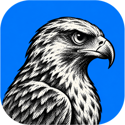

# DownCraft

### Download without limits.

**A native, open-source download manager written in Rust.**<br>
Up to **32 parallel connections** per file · safe resume · HLS streams · one-click video grabbing from your browser.


[**Watch the intro**](#-see-it-in-motion) ·
[**Screenshots**](#-a-tour-of-the-app) ·
[**Features**](#-features) ·
[**Browser extension**](#-browser-extension) ·
[**Install**](#-install--build)

<br>

<picture>
  <source media="(prefers-color-scheme: light)" srcset="assets/screenshots/main-light.webp">
  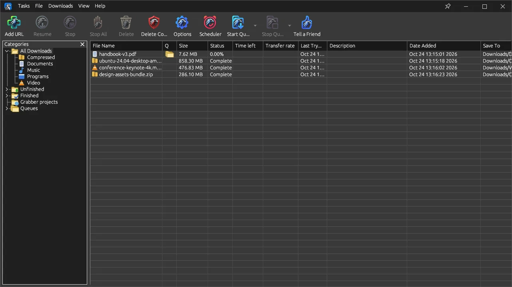
</picture>

<sub>The main window. Toolbar on top, categories on the left, your downloads on the right. It follows your GitHub light or dark theme.</sub>

</div>

<br>

## 🎬 See it in motion

<div align="center">

[](https://youtu.be/RG9xaAKEFyo)

<sub>▶ Click to watch the intro on YouTube.</sub>

</div>

<br>

## ✨ At a glance

| | | | |
|:---:|:---:|:---:|:---:|
| **32**<br><sub>connections per file</sub> | **24 h**<br><sub>per-host limits remembered</sub> | **6**<br><sub>themes, 8 accent colours</sub> | **3**<br><sub>operating systems</sub> |

DownCraft keeps the layout and workflow of Internet Download Manager (toolbar, category tree, *Download File Info*, per-connection progress) and puts a fast, modern engine under it.

<br>

## 🖼 A tour of the app

### 1 · Start a download

Paste a link into **Add URL** and the *Download File Info* dialog opens. It shows the file's detected category and where it will be saved, so you can start now or queue it for later.

<div align="center">
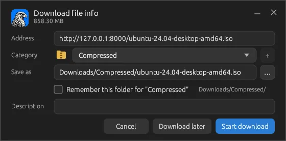
</div>

- Several URLs at once: paste one per line.
- File name comes from `Content-Disposition` or the URL.
- Files are sorted into **Compressed, Documents, Music, Programs or Video**, each with its own folder, and you can tick *Remember this folder*.

### 2 · Watch every connection

The progress window is where the segmented engine becomes visible. Each lane shows its start position and how many bytes it has received, live.

<div align="center">
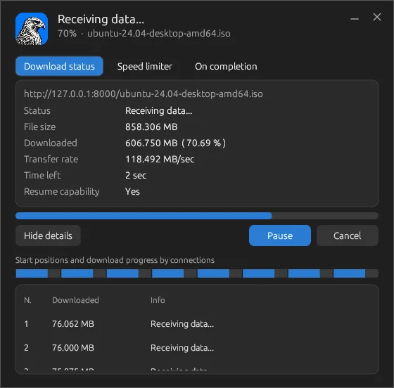
</div>

- **Per-connection map**: a coloured bar of the whole file plus one row per connection.
- **Speed limiter** and **On completion** tabs sit right next to the status.
- *Resume capability* tells you at a glance whether the server supports `Range` requests.

### 3 · Done

A *Download complete* dialog gives you **Open**, **Open folder** and **Open with…** in one click. You can switch the dialog off if you'd rather not see it.

<div align="center">
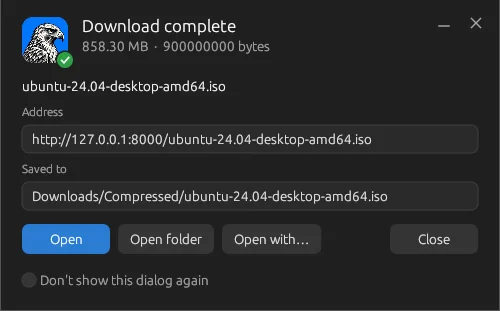
</div>

### 4 · Tune everything

**Options** is a tabbed window with nine pages: General, File types, Save to, Downloads, Connection, Proxy / Socks, Site logins, Network and Sounds.

<div align="center">
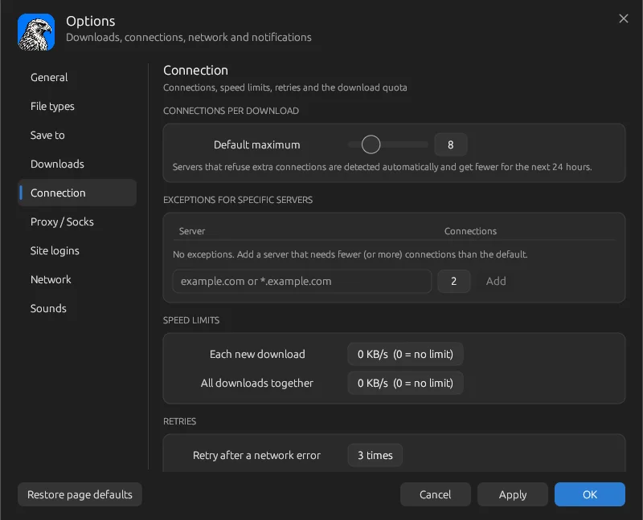
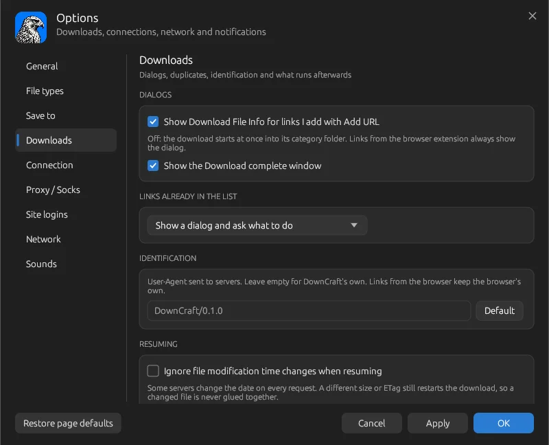
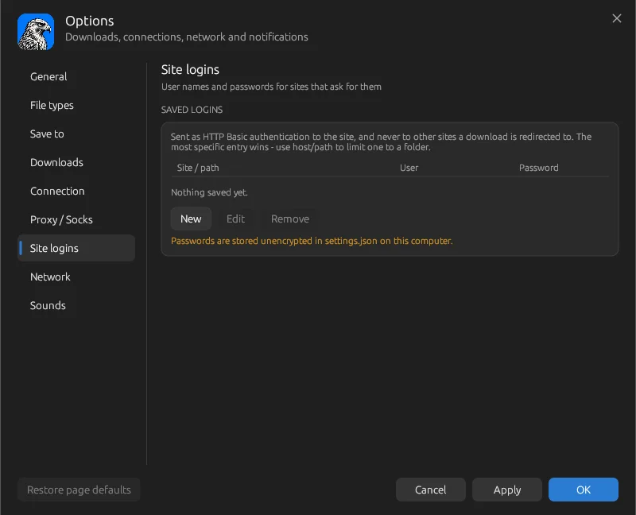
</div>

<table>
<tr>
<td width="33%" valign="top"><b>Connection</b><br><sub>Default maximum, exceptions for specific servers, per-download and global speed limits, retries, download quota.</sub></td>
<td width="33%" valign="top"><b>Downloads</b><br><sub>When dialogs appear, how duplicate links are handled, the User-Agent sent to servers, how resuming behaves.</sub></td>
<td width="33%" valign="top"><b>Site logins</b><br><sub>HTTP Basic credentials, applied only to the site or path you set. Stored unencrypted in the settings file on your computer.</sub></td>
</tr>
</table>

### 5 · Make it yours

Six built-in themes, switchable from the **View** menu, plus eight accent colours (Blue, Teal, Green, Orange, Red, Pink, Purple, Yellow).

<div align="center">
<table>
<tr>
<td align="center"><br><sub><b>Dark</b></sub></td>
<td align="center">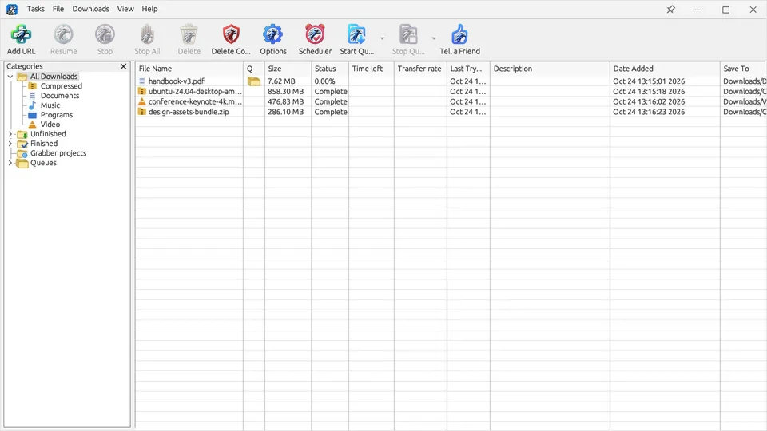<br><sub><b>Light</b></sub></td>
<td align="center">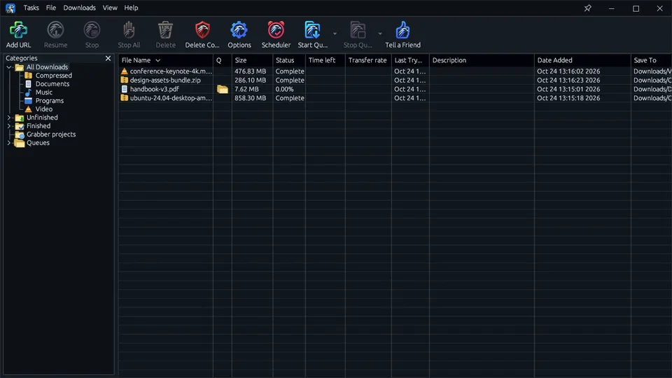<br><sub><b>Midnight</b></sub></td>
</tr>
<tr>
<td align="center">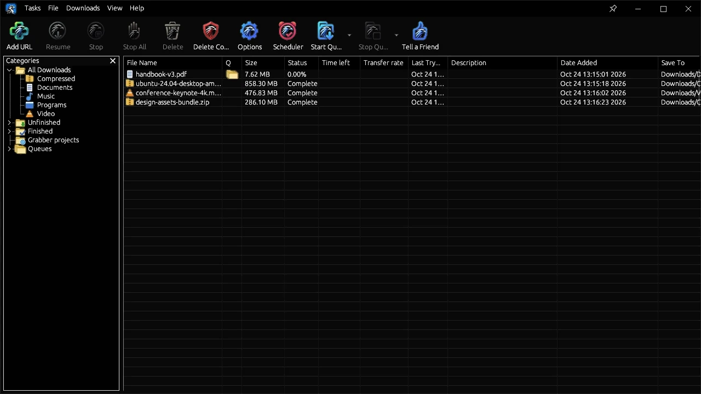<br><sub><b>AMOLED</b></sub></td>
<td align="center">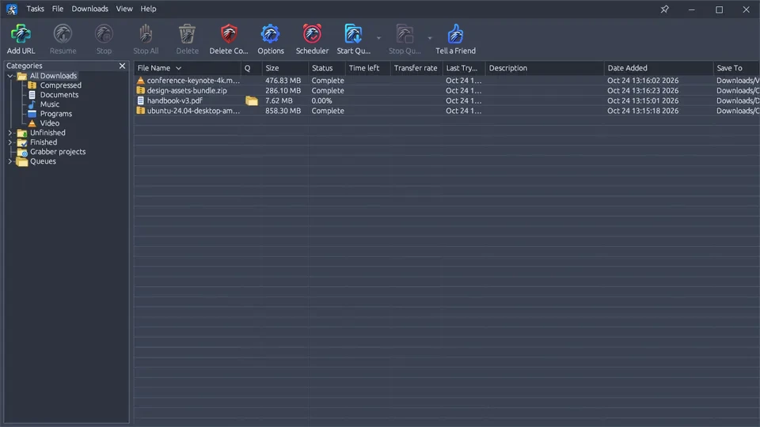<br><sub><b>Nord</b></sub></td>
<td align="center">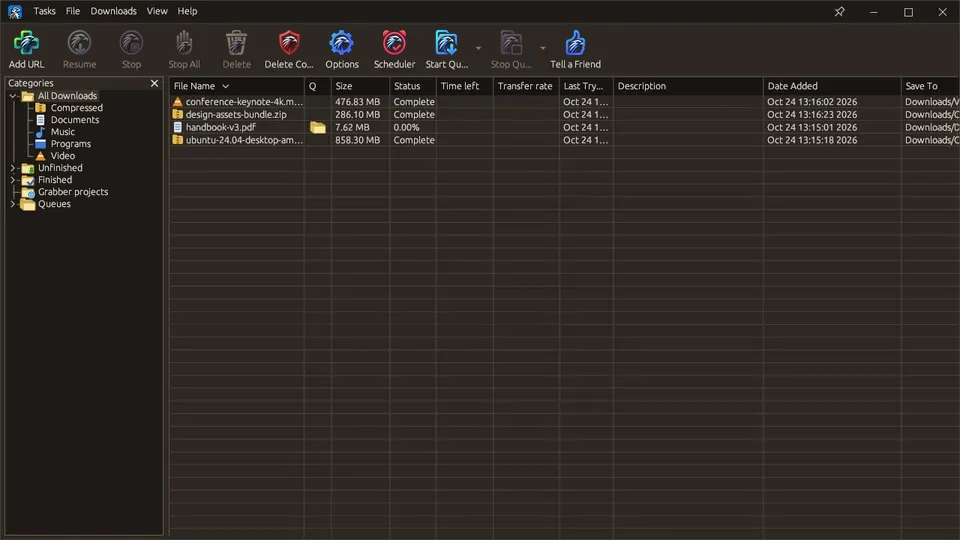<br><sub><b>Mocha</b></sub></td>
</tr>
</table>
</div>

<br>

## ⚡ How the engine works

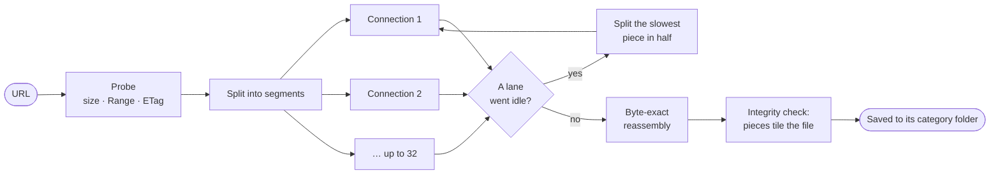

- **Dynamic segmentation.** When a connection finishes, it takes the second half of the slowest remaining piece, so one slow lane never drags out the finish.
- **Adaptive connections.** If a server answers extra connections with `429`, `403` or `503`, DownCraft uses fewer of them for that host and remembers it for 24 hours.
- **Dead-connection detection.** 30 seconds without data triggers a reconnect.
- **Safe resume.** State is saved in `downloads.json`. On resume, ETag and size are re-checked, and a file that changed on the server restarts instead of being corrupted.
- **Single-connection fallback** when a server has no `Range` support.

<br>

## 🧩 Browser extension

`crates/app/extension/` is a **Manifest V3** extension for Chrome, Edge, Brave and Opera.

<div align="center">

</div>

- **Download this video** button in the corner of any video you hover. Drag it anywhere, hide it per page with **X**, get help with **?**.
- Takes over browser downloads (**Alt+click** bypasses it) and adds a right-click **Download with DownCraft**.
- Direct links and HLS streams are sent with Referer and cookies.
- On YouTube, Facebook, Instagram, X and other video sites, formats found by yt-dlp are listed as *Video + audio*, *Video only* and *Audio only*, with codec and size.
- **Private by design:** it talks to the app only through a loopback endpoint (`127.0.0.1:19870`), and nothing downloads until you confirm.

<div align="center">
<table>
<tr>
<td align="center">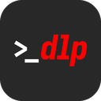<br><sub><b>yt-dlp</b><br>video sites</sub></td>
<td align="center"><br><sub><b>ffmpeg</b><br>joins picture + sound</sub></td>
<td align="center"><br><sub><b>Deno</b><br>runs YouTube's scripts for yt-dlp</sub></td>
</tr>
</table>

<sub>Install all three from <b>Tasks → Tools</b>.</sub>
</div>

On first start, a **Set up DownCraft** window offers the extension (on Windows and macOS drag the logo onto `chrome://extensions`; on Linux use **Load unpacked** with the folder the window shows) and each helper tool with a *Get* button. Reopen it any time from **Tasks → Setup guide…**. More in [`crates/app/extension/README.md`](crates/app/extension/README.md).

<br>

## 🛠 Toolbar

One row, everything within reach, IDM-style. Want a different look? **Options → Toolbar icons → Load skin (.zip)…** takes an IDM skin pack, and *Reset* brings the built-in icons back.

<div align="center">
<table>
<tr>
<td align="center" width="90">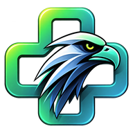<br><sub><b>Add URL</b></sub></td>
<td align="center" width="90">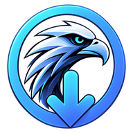<br><sub><b>Resume</b></sub></td>
<td align="center" width="90">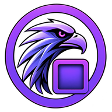<br><sub><b>Stop</b></sub></td>
<td align="center" width="90">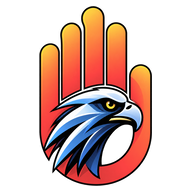<br><sub><b>Stop All</b></sub></td>
<td align="center" width="90">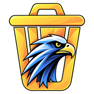<br><sub><b>Delete</b></sub></td>
<td align="center" width="90">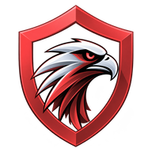<br><sub><b>Delete Completed</b></sub></td>
</tr>
<tr>
<td align="center">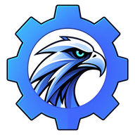<br><sub><b>Options</b></sub></td>
<td align="center">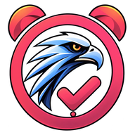<br><sub><b>Scheduler</b></sub></td>
<td align="center">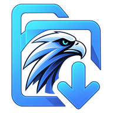<br><sub><b>Start Queue</b></sub></td>
<td align="center">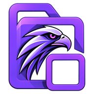<br><sub><b>Stop Queue</b></sub></td>
<td align="center">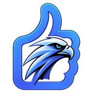<br><sub><b>Tell a Friend</b></sub></td>
<td></td>
</tr>
</table>
</div>

**Set it, then walk away.** Run the main queue, schedule it, and choose what happens when it ends: do nothing, close, sleep or shut down (with a 60-second cancel countdown).

<br>

## 📋 Features

<details open>
<summary><b>Engine</b></summary>

- Segmented downloads: up to 32 parallel connections per file, byte-exact reassembly
- **Dynamic segmentation** (from FluxDown): idle connections split the slowest piece in half
- **Adaptive connections**: hosts that push back get fewer connections, remembered for 24 h
- Dead-connection detection (30 s without data → reconnect), instant pause, integrity check that the pieces tile the file
- Resume validation: ETag / size are re-checked, and a changed file restarts instead of being corrupted
- Pause / resume across restarts, automatic retry with back-off, disk-space check
- Falls back to a single connection when the server has no `Range` support
- Global and per-download speed limits (shared pacing)
- HTTP / SOCKS5 / system proxy

</details>

<details open>
<summary><b>Video & streams</b></summary>

- **Video sites via yt-dlp:** paste a Facebook, Instagram, X / Twitter, TikTok, YouTube, Vimeo, Reddit … post into *Add URL* (or press *As video* for any other site yt-dlp knows) and pick a quality. Posts with several videos list each one.
- Picture and sound that arrive as two files are downloaded by the normal engine and joined with ffmpeg.
- Posts that need a sign-in work through the browser extension's cookies or *Options → Downloads → Video sites*.
- **HLS (`.m3u8`) streams:** best quality picked, AES-128 decrypted, `EXT-X-BYTERANGE` supported, parallel segments, resumable, saved as one `.ts` / `.mp4`.

</details>

<details>
<summary><b>Organisation & automation</b></summary>

- Automatic category (Compressed, Documents, Music, Programs, Video) with per-category folders and *Remember this path*
- Main download queue, Start / Stop queue, **Scheduler**
- Action when the queue ends: close, sleep or shut down
- **Clipboard monitor** offers to download links you copy, filtered by file type
- Start at login / minimised, system tray where the platform supports it
- A command to run after each download (for example a virus scan), event sounds

</details>

<details>
<summary><b>Options & networking</b></summary>

- Per-server connection limits, download quota, duplicate-link handling
- Site logins (HTTP Basic), proxy with credentials and bypass list
- IPv4 / IPv6 and outgoing-address choice, timeouts
- **Toolbar skins:** load an IDM-style skin pack (a `.tbi` plus normal and "hot" `.bmp` strips of 12 icons; 32-bit alpha, or 24-bit with magenta as the transparent colour). It is remembered across restarts.
- **Portable mode:** create a `downcraft-data/` folder next to the executable and everything stays with it

</details>

<br>

## 📦 Install & build

Download the latest build for your platform from the **[Releases](https://github.com/RahulDasEmon/Downcraft/releases/latest)** page. Each release ships a portable zip for Windows, macOS (Apple Silicon and Intel) and Linux.

Or build from source:

```bash
cargo run --release -p downcraft-app       # needs Rust 1.82+
cargo test -p downcraft-core               # engine tests (local Range server)
cargo test -p downcraft-app                # toolbar-skin importer tests
```

<details>
<summary>Linux build dependencies</summary>

```bash
sudo apt-get install libxkbcommon-dev libwayland-dev \
  libxcb-render0-dev libxcb-shape0-dev libxcb-xfixes0-dev
```

</details>

<br>

## 🗂 Project layout

```
crates/core         download engine (no GUI): probe, segments, resume, queue, persistence
crates/app          egui / eframe desktop UI  →  binary `downcraft`
crates/app/extension  Manifest V3 browser extension (packed into the app at build time)
assets/             logo, toolbar icons, screenshots
```

## 🧭 Roadmap

MPEG-DASH · FTP · separate HLS audio tracks · custom categories · site grabber · proxy auto-config (PAC) scripts · a separate temporary folder for part files

## 👨‍💻 Developer

<table>
<tr>
<td width="150" align="center" valign="middle">
<a href="https://github.com/RahulDasEmon">

</a>
</td>
<td valign="middle">

### Rahul Das Emon
<sub><b>CREATOR & MAINTAINER OF DOWNCRAFT</b></sub>

Designed and built in Rust, from the segmented download engine to the native UI.<br>
Found a bug or have an idea? Open an issue or say hello on GitHub.

[](https://github.com/RahulDasEmon)
[](https://github.com/RahulDasEmon)

</td>
</tr>
</table>

<sub>The same card lives inside the app: <b>Help → About DownCraft</b>.</sub>

## ⚖️ Legal

DownCraft is an independent project, not affiliated with Tonec Inc. It contains no IDM code or assets.
Released under the [MIT license](LICENSE).

## ⭐ Star history

<a href="https://www.star-history.com/#RahulDasEmon/Downcraft&Date">
  <picture>
    <source media="(prefers-color-scheme: dark)" srcset="https://api.star-history.com/svg?repos=RahulDasEmon/Downcraft&type=Date&theme=dark" />
    <source media="(prefers-color-scheme: light)" srcset="https://api.star-history.com/svg?repos=RahulDasEmon/Downcraft&type=Date" />
    
  </picture>
</a>

<div align="center">
<br>
<sub>Made with Rust 🦀 and a hawk 🦅</sub>
</div>
